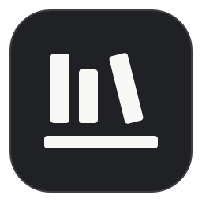
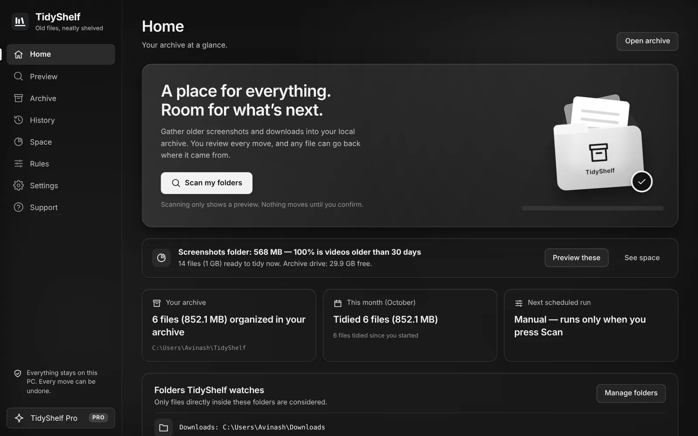
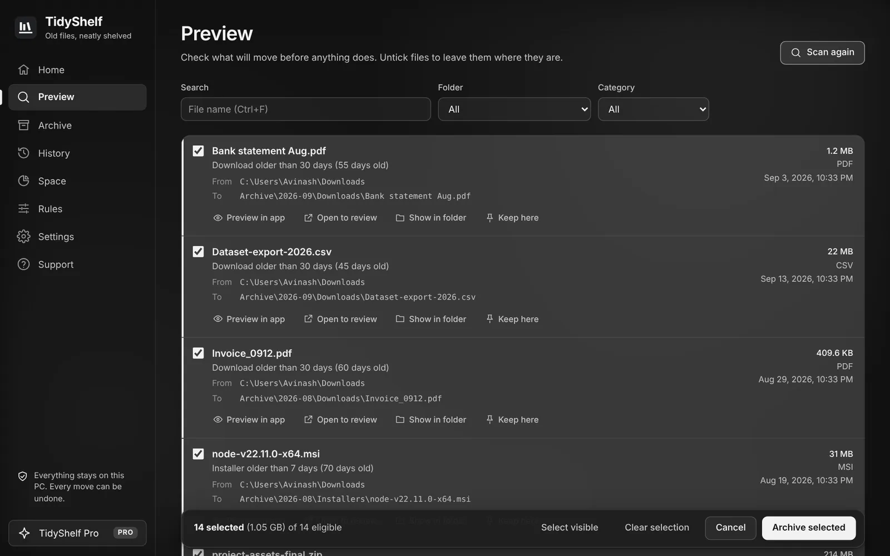
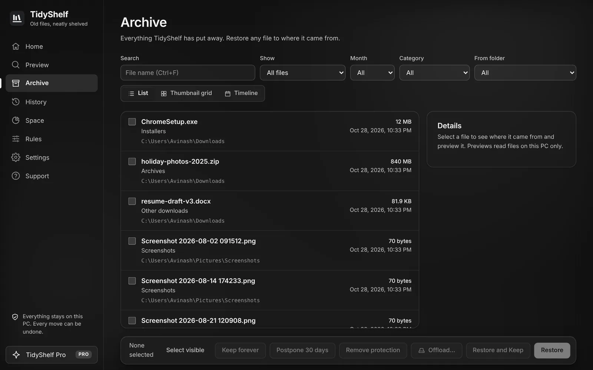
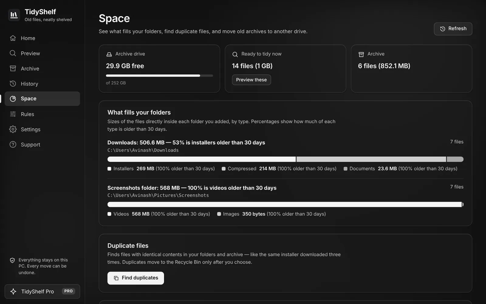

<h1 align="center">TidyShelf</h1>

Old files, neatly shelved — a Windows app that moves old screenshots and downloads into a tidy local archive you can always restore from.

  <a href="https://apps.microsoft.com/detail/9N570LV3WMT7">Microsoft Store</a> ·
  <a href="https://tidy-shelf-official.vercel.app">Website</a> ·
  <a href="https://github.com/Avenger11764/Tidyshelf/issues/new/choose">Report a bug or suggest a feature</a> ·
  <a href="https://tidy-shelf-official.vercel.app/privacy">Privacy</a>

This repository is the **public home for TidyShelf support**: bug reports, feature ideas, questions and release notes. The app's source code is private.

## What TidyShelf does

**Latest release: [TidyShelf 1.0.5](https://github.com/Avenger11764/Tidyshelf/releases/tag/v1.0.5)** — send unwanted files to the Recycle Bin from Review or Archive, preview files without scrolling, and rate the app from Settings → Help. [Get the update from Microsoft Store](https://apps.microsoft.com/detail/9N570LV3WMT7).

- **Preview, then archive** old screenshots, installers, zips, documents and videos from Desktop, Downloads, Screenshots and your own folders.
- **Restore anything** to its original place, or **undo a whole run** from History.
- **Search** your archive by name, and by the text inside screenshots (Windows OCR, on your PC).
- **Space report**, **duplicate finder**, **Keep forever** protection, and automatic **download sorting**.
- **Everything stays on your PC.** No account, no cloud, no analytics.
- **Pro** is a one-time purchase in the Microsoft Store. It adds scheduled archiving, custom rules, and unlimited folders and drives.

| Preview | Archive | Space |
|---|---|---|
|  |  |  |

## Get help

| I want to… | Do this |
|---|---|
| Report a bug | **In the app:** Support → *Report a problem*. It can attach logs privately. **Or here:** [open a bug report](https://github.com/Avenger11764/Tidyshelf/issues/new?template=bug_report.yml) |
| Suggest a feature | [Open a feature request](https://github.com/Avenger11764/Tidyshelf/issues/new?template=feature_request.yml), or 👍 an existing one |
| Ask a question | Check the [FAQ](https://tidy-shelf-official.vercel.app/#faq), then [contact support](https://tidy-shelf-official.vercel.app/contact) |
| Get Pro back on a new PC | TidyShelf → Support → **Restore purchases** (same Microsoft account) |
| Report a security issue | See [SECURITY.md](SECURITY.md). Please don't open a public issue |

> Issues here are **public**. Don't paste personal information, full file paths, or logs that contain file names. To send logs privately, use *Report a problem* in the app.

## Finding your app version and logs

- **Version:** TidyShelf → Support (top card).
- **Logs:** TidyShelf → Settings → Privacy → *Export diagnostics…* (file names are hidden by default).

## Release notes

See [CHANGELOG.md](CHANGELOG.md) and [Releases](https://github.com/Avenger11764/Tidyshelf/releases). Once a day, TidyShelf checks the latest release here and tells you when an update is available in the Microsoft Store.

## Frequently asked

**Does TidyShelf delete files?** No. It moves them into your archive folder on the same drive and records where each one came from. Optional archive cleanup sends files to the Recycle Bin. It's off unless you turn it on.

**Does it work with OneDrive, Dropbox or Google Drive?** Synced folders are scan-only. TidyShelf never moves files that a sync app manages.

**Is Pro a subscription?** No. It's a one-time purchase through the Microsoft Store.

---

© 2026 Avinash. TidyShelf is free to download. The source code is not open source.
